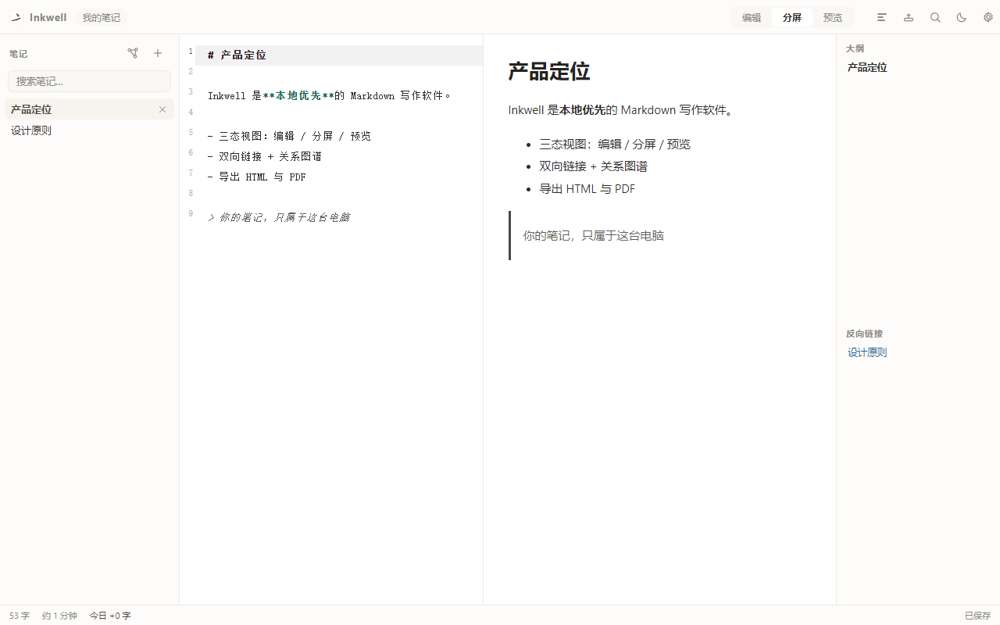

<div align="center">

&nbsp;&nbsp;<font size="6">**Inkwell**</font>

**Quiet writing. Notes stay on this machine.**

[](https://github.com/skpcd/inkwell/releases)
[](#download)
[](LICENSE)

[中文](./README.md) · **English** · [日本語](./README.ja.md)

[Download](#download) · [Features](#features) · [Development](#development)

</div>

---

Inkwell is a **local-first** Markdown writing app: open a folder, and that folder is your vault. Your `.md` files stay yours — no database, no cloud, no account. Quiet writing, on your machine.



## Features

| | |
|---|---|
| ✍️ **Three-pane views** | Edit / Split / Preview with one click, split by default |
| 🔗 **Bidirectional links** | `[[wiki links]]` with aliases, click to jump or create |
| 🕸 **Graph view** | Dependency-free force-directed graph of your notes |
| 📋 **Outline panel** | Clickable headings, synced scrolling in preview |
| 🔎 **Full-text search** | Across all notes with context snippets (`Ctrl+Shift+F`) |
| ⚡ **Quick switcher** | Recently-used-first note switching (`Ctrl+P`) |
| 🖼 **Image paste** | Paste screenshots straight into notes |
| 🗑 **Trash** | Soft delete with restore — no accidental loss |
| 📤 **Export** | Self-contained single-file HTML + PDF |
| 🌗 **Themes** | Light/dark (follows system) × 5 accent colors |
| 🌍 **Trilingual UI** | 中文 / English / 日本語 |
| ⌨️ **Command palette** | `Ctrl+K`, one entry point for everything |
| 🔄 **Auto-update** | In-app update check with progress bar |

## Download

Grab the latest build from [Releases](https://github.com/skpcd/inkwell/releases):

| Platform | File | Notes |
|----------|------|-------|
| Windows | `Inkwell-Setup-*.exe` | Guided installer, choose directory |
| Linux | `*.AppImage` / `*.deb` | AppImage runs without install |
| macOS | `*-arm64-mac.zip` | Apple Silicon; unsigned — right-click → Open to bypass Gatekeeper |

> Builds are unsigned: on Windows SmartScreen, choose "More info → Run anyway"

## Development

```bash
npm install        # install dependencies
npm run dev        # web preview @ http://localhost:5178
npm run typecheck  # TypeScript type check
npm run electron:dev    # build & launch desktop app
npm run electron:build  # produce installers to release/
```

Stack: Electron · Vite · TypeScript (no framework, vanilla DOM) · CodeMirror 6 · marked + DOMPurify

## License

MIT
