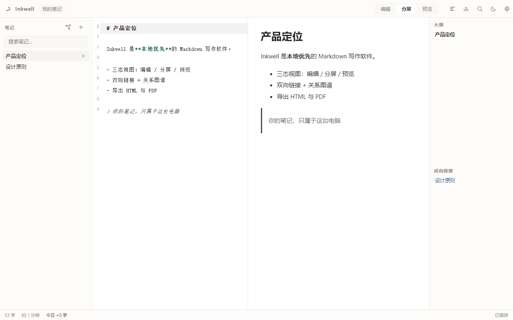

<div align="center">

&nbsp;&nbsp;<font size="6">**页泊 · Pageberth**</font>

**言葉が静かに泊まる場所。**

[](https://github.com/afustellar/inkwell/releases)
[](#ダウンロード)
[](LICENSE)

[中文](./README.md) · [English](./README.en.md) · **日本語**

[ダウンロード](#ダウンロード) · [機能](#機能) · [開発](#開発)

</div>

---

页泊（Pageberth）は**ローカルファースト**の Markdown ライティングアプリです。フォルダを開けば、それがそのままあなたのボルト。`.md` ファイルは常にあなたのもの — データベースなし、クラウドなし、アカウントなし。



## 機能

| | |
|---|---|
| ✍️ **3 種類の表示** | 編集 / 分割 / プレビューをワンクリックで切替、標準は分割 |
| 🎨 **コードハイライト** | 編集・プレビュー・HTML/PDF 書き出しで言語別に色分け、ライト/ダーク対応 |
| 🔗 **双方向リンク** | `[[リンク]]` で自動接続、クリックで開くか作成、エイリアス対応 |
| 🕸 **グラフビュー** | ノート同士のつながりを力指向グラフで可視化 |
| 📋 **アウトライン** | 見出しジャンプ、プレビュー同期スクロール |
| 🔎 **全文検索** | 全ノート横断検索、文脈スニペット付き（`Ctrl+Shift+F`） |
| 📂 **外部変更の同期** | 外部での追加・削除・名前変更を一覧、検索、グラフに反映。未保存の競合は両方の版を比較し、ローカル版を別名保存するかディスク版を読み込み可能 |
| ⌨️ **長文入力** | 入力中は集計とプレビューの更新待ちを表示。入力が止まると文字数・読書時間・分割プレビューを更新し、保存待ちと保存中を区別 |
| ⚡ **クイックスイッチ** | 最近使用順のノート切替（`Ctrl+P`） |
| 🖼 **画像貼付** | ボルト内のノートに画像を貼り付け、`assets/` に保存 |
| 🗑 **ゴミ箱** | 削除はゴミ箱経由、復元可能 |
| 📤 **書き出し** | 単一ファイル HTML + PDF |
| 🌗 **テーマ** | ライト/ダーク（システム追従）× 5 カラー |
| 🌍 **3 言語 UI** | 中文 / English / 日本語 |
| ⌨️ **コマンドパレット** | `Ctrl+K` ですべての操作にアクセス |
| 🔄 **自動更新** | アプリ内で更新確認、プログレスバー付き |

## ダウンロード

[Releases](https://github.com/afustellar/inkwell/releases) から最新ビルドを入手：

| プラットフォーム | ファイル | 備考 |
|------------------|----------|------|
| Windows | `Pageberth Setup *.exe` | ガイド付きインストーラ、保存先を選択可能 |
| Linux | `*.AppImage` / `*.deb` | AppImage はインストール不要 |
| macOS | `*-arm64-mac.zip` | Apple Silicon。未署名のため右クリック → 開く |

> ビルドは未署名：Windows SmartScreen では「詳細情報 → 実行」を選択してください

## 開発

```bash
npm install        # 依存関係のインストール
npm run dev        # Web プレビュー @ http://localhost:5178
npm run typecheck  # TypeScript 型チェック
npm run icons      # SVG からアプリ・インストーラ・SNS 用アイコンを再生成
npm run electron:dev    # ビルドしてデスクトップアプリを起動
npm run electron:build  # release/ にインストーラを生成
```

スタック：Electron · Vite · TypeScript（フレームワークなし、素の DOM）· CodeMirror 6 · marked + DOMPurify · highlight.js

単一ファイルだけを開いた場合、アクセス権はそのファイルに限られます。画像を貼り付けるには、そのファイルのフォルダをボルトとして開いてください。名称変更後もアプリ識別子と設定保存先は維持されます。既存の Releases のインストーラ名は Inkwell のままです。

## License

MIT
