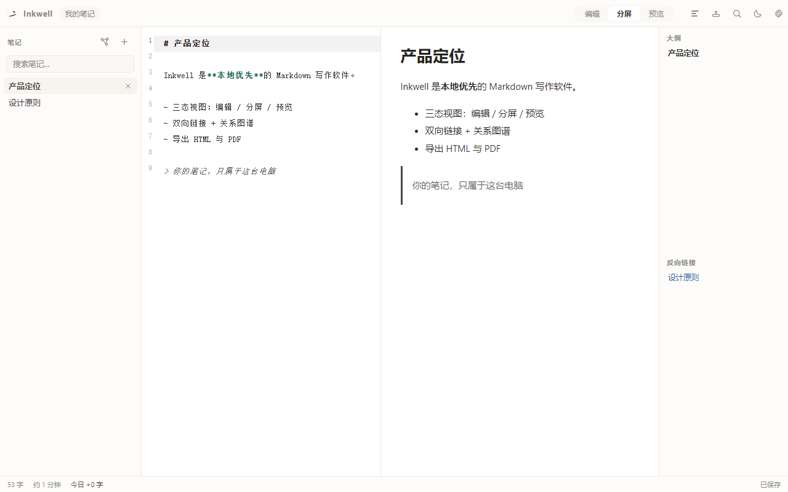

&nbsp;&nbsp;**Inkwell**

**安静写作，笔记留在本机**

[下载安装](#下载安装) · [功能一览](#功能一览) · [开发](#开发)
[Download](#download--english) · [機能](#機能--日本語)

---

## 中文

Inkwell 是**本地优先**的 Markdown 写作软件：打开一个文件夹就是你的资料库，`.md` 文件永远是你的文件。不搞数据库、不搞云、不搞账号 —— 安静写作，笔记留在本机。

### 功能一览

| | |
|---|---|
| ✍️ **三态视图** | 编辑 / 分屏 / 预览，一键切换，默认分屏 |
| 🔗 **双向链接** | `[[笔记名]]` 自动建链，点击跳转或创建，支持别名 |
| 🕸 **关系图谱** | 零依赖力导向图，节点按连接数加权，孤岛笔记一目了然 |
| 📋 **大纲面板** | 六级标题目录，点击跳行，预览模式同步滚动 |
| 🔎 **全文搜索** | 跨笔记搜内容，带上下文片段（`Ctrl+Shift+F`） |
| ⚡ **快速切换** | 最近打开优先的笔记切换器（`Ctrl+P`） |
| 🖼 **图片粘贴** | 剪贴板截图直接贴进笔记，存入 `assets/` |
| 🗑 **回收站** | 删除先进回收站，可恢复，防手滑 |
| 📤 **导出** | 自包含单文件 HTML + PDF |
| 🌗 **主题系统** | 明暗模式（可跟随系统）× 5 种主题色 |
| 🌍 **三语界面** | 中文 / English / 日本語 |
| ⌨️ **命令面板** | `Ctrl+K`，所有操作的统一入口 |
| 🔄 **自动更新** | 应用内检查更新，进度条 + 重启安装 |

### 下载安装

从 [Releases](https://github.com/skpcd/inkwell/releases) 下载：

| 平台 | 文件 | 说明 |
|------|------|------|
| Windows | `Inkwell-Setup-*.exe` | 引导式安装，可选目录 |
| Linux | `*.AppImage` / `*.deb` | AppImage 免安装直接运行 |
| macOS | `*-arm64-mac.zip` | Apple Silicon；未签名，右键打开绕过 Gatekeeper |

> 构建未签名：Windows SmartScreen 提示请选「更多信息 → 仍要运行」

---

## English

Inkwell is a **local-first** Markdown writing app: open a folder, and that folder is your vault. Your `.md` files stay yours — no database, no cloud, no account. Quiet writing, on your machine.

### Features

| | |
|---|---|
| ✍️ **Three-pane views** | Edit / Split / Preview with one click |
| 🔗 **Bidirectional links** | `[[wiki links]]` with aliases, click to jump or create |
| 🕸 **Graph view** | Dependency-free force-directed graph of your notes |
| 📋 **Outline panel** | Clickable headings, synced scrolling in preview |
| 🔎 **Full-text search** | Across all notes with context snippets (`Ctrl+Shift+F`) |
| ⚡ **Quick switcher** | Recently-used-first note switching (`Ctrl+P`) |
| 🖼 **Image paste** | Paste screenshots straight into notes |
| 🗑 **Trash** | Soft delete with restore — no accidental loss |
| 📤 **Export** | Self-contained single-file HTML + PDF |
| 🌗 **Themes** | Light/dark (follows system) × 5 accent colors |
| 🌍 **Trilingual UI** | 中文 / English / 日本語 |
| ⌨️ **Command palette** | `Ctrl+K`, one entry point for everything |
| 🔄 **Auto-update** | In-app update check with progress bar |

### Download

Grab the latest build from [Releases](https://github.com/skpcd/inkwell/releases):

| Platform | File | Notes |
|----------|------|-------|
| Windows | `Inkwell-Setup-*.exe` | Guided installer, choose directory |
| Linux | `*.AppImage` / `*.deb` | AppImage runs without install |
| macOS | `*-arm64-mac.zip` | Apple Silicon; unsigned — right-click → Open to bypass Gatekeeper |

---

## 機能 / 日本語

Inkwell は**ローカルファースト**の Markdown ライティングアプリです。フォルダを開けば、それがそのままあなたのボルト。`.md` ファイルは常にあなたのもの — データベースなし、クラウドなし、アカウントなし。

### 主な機能

| | |
|---|---|
| ✍️ **3 種類の表示** | 編集 / 分割 / プレビューをワンクリックで切替 |
| 🔗 **双方向リンク** | `[[リンク]]` で自動接続、クリックで開くか作成 |
| 🕸 **グラフビュー** | ノート同士のつながりを力指向グラフで可視化 |
| 📋 **アウトライン** | 見出しジャンプ、プレビュー同期スクロール |
| 🔎 **全文検索** | 全ノート横断検索（`Ctrl+Shift+F`） |
| ⚡ **クイックスイッチ** | 最近使用順のノート切替（`Ctrl+P`） |
| 🖼 **画像貼付** | スクリーンショットを直接貼り付け |
| 🗑 **ゴミ箱** | 削除はゴミ箱経由、復元可能 |
| 📤 **書き出し** | 単一ファイル HTML + PDF |
| 🌗 **テーマ** | ライト/ダーク（システム追従）× 5 カラー |
| 🌍 **3 言語 UI** | 中文 / English / 日本語 |
| ⌨️ **コマンドパレット** | `Ctrl+K` ですべてにアクセス |
| 🔄 **自動更新** | アプリ内で更新確認、プログレスバー付き |

### ダウンロード

[Releases](https://github.com/skpcd/inkwell/releases) から最新ビルドを入手してください：

| プラットフォーム | ファイル | 備考 |
|------------------|----------|------|
| Windows | `Inkwell-Setup-*.exe` | ガイド付きインストーラ |
| Linux | `*.AppImage` / `*.deb` | AppImage はインストール不要 |
| macOS | `*-arm64-mac.zip` | Apple Silicon。未署名のため右クリック → 開く |

---

MIT License · built with Electron · Vite · TypeScript · CodeMirror 6

